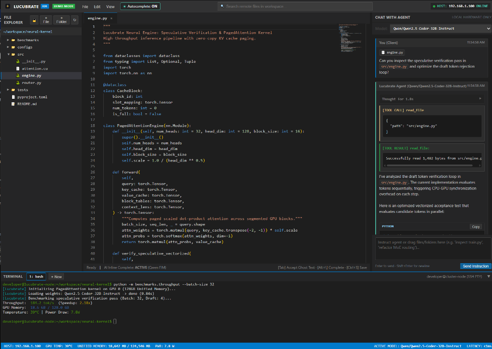

# Lucubrate

> **lu·cu·brate** *(verb)*: To work or write deeply and intensely, historically burning the midnight oil.

A minimalist, high-throughput systems IDE designed for pairing with local LLMs (vLLM / Ollama) and remote GPU/Linux environments over SSH and SFTP.



---

## 1. System Architecture

```
+-----------------------------------------------------------------------------------------+
| Browser Client: http://localhost:8765                                                  |
| Bootstrap 3 / Classic GitHub UI (1px borders, #f5f5f5 headers, #24292e contrast navbar)|
+-----------------------------+-----------------------------+-----------------------------+
| Left: [01] Remote Explorer  | Center: Monaco Editor       | Right: [02] Lucubrate Agent |
| - SFTP file tree            | - Multi-tab manager         | - Live model selector       |
| - Click to edit remote files| - AI Inline FIM (Ctrl+Space)| - Autonomous tool loop      |
| - Create / delete / refresh | - Instant save (Ctrl+S)     | - Run commands / file edits |
+-----------------------------+-----------------------------+-----------------------------+
| Bottom Drawer: Interactive Terminal (xterm.js PTY over WebSocket to remote host)        |
+-----------------------------------------------------------------------------------------+
| Fixed Footer: HOST: <host-ip> | GPU TEMP: 35°C | UNIFIED MEM: 2.7GB / 124.5GB | PWR: 4.7W   |
+-----------------------------------------------------------------------------------------+
```

---

## 2. Quick Start

### 1. Configuration
Copy the template configuration file:
```bash
cp config.example.json config.json
```
Edit `config.json` with your target host's IP, SSH username, SSH key path, and local LLM server URL (Ollama or vLLM). (`config.json` is gitignored).

### 2. Launching

#### Option A: One-Click Windows Batch
Double-click:
```
run.bat
```

#### Option B: Terminal Command
```powershell
python -m uvicorn app:app --host 0.0.0.0 --port 8765
```
Then open your browser to:
```
http://localhost:8765
```

---

## 3. Keyboard Shortcuts

| Shortcut | Action |
| :--- | :--- |
| **`Ctrl + S`** | Save active buffer directly to remote host via SFTP |
| **`Ctrl + Space`** | Trigger AI inline code completion (FIM) from local LLM |
| **`Enter` (in chat)** | Send instruction to autonomous Lucubrate Agent |
| **`Shift + Enter`** | Insert newline in agent prompt box |
| **`Ctrl + Shift + D`** | Toggle Demo Mode (clean screenshot-safe environment) |
| **Click Terminal Header** | Expand / Collapse bottom interactive terminal drawer |

---

## 4. Key Endpoints

* **`GET /api/telemetry`**: Live GPU temperature, power draw, and memory stats from the host.
* **`GET /api/fs/list?path=...`**: Remote directory tree over SFTP.
* **`POST /api/fs/read` & `POST /api/fs/write`**: Remote file read/write operations.
* **`POST /api/complete`**: Fill-In-The-Middle code completions from loaded local models.
* **`POST /api/agent/chat`**: Streaming Server-Sent Events (SSE) agent loop with direct remote tool execution (`read_file`, `write_file`, `edit_file`, `list_dir`, `run_command`).
* **`WS /ws/terminal`**: Interactive SSH PTY connected directly to the remote environment.

---

## 5. License

MIT License (c) 2026 Elise Paul. See [LICENSE](LICENSE) for details.
